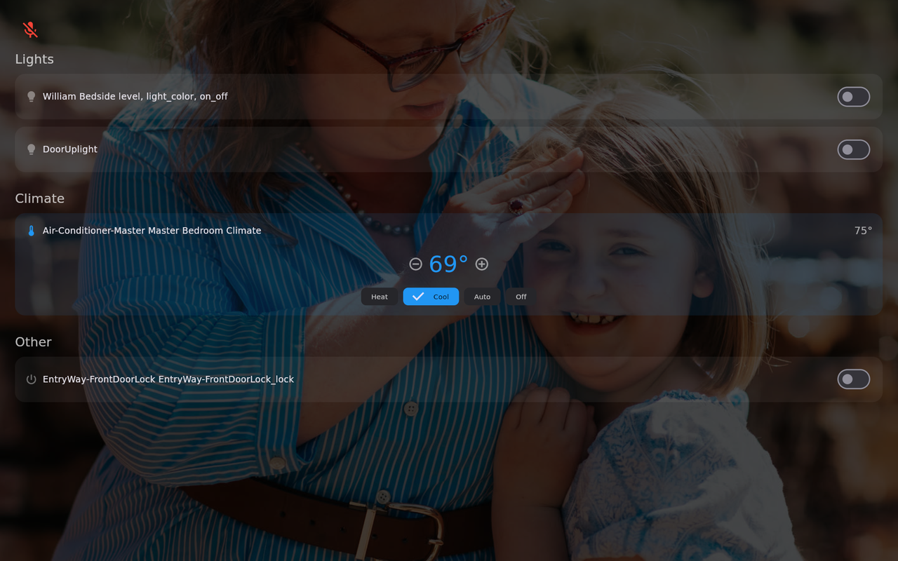
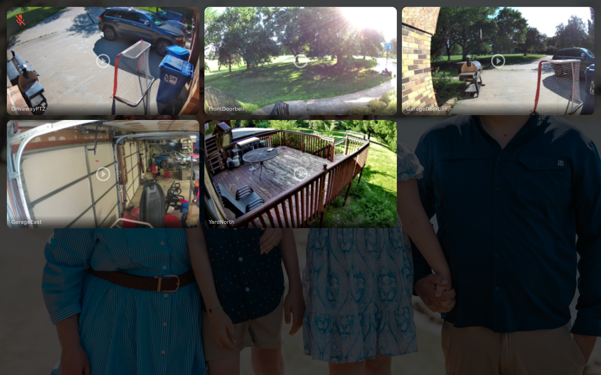
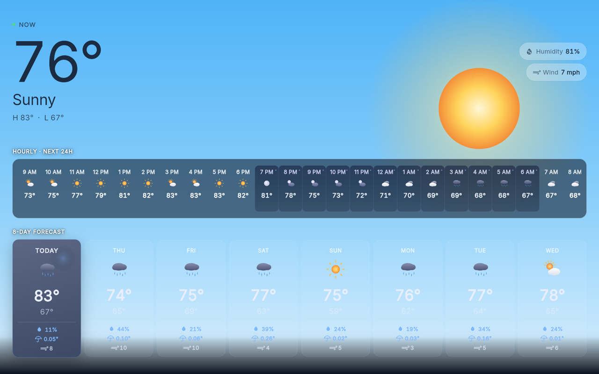
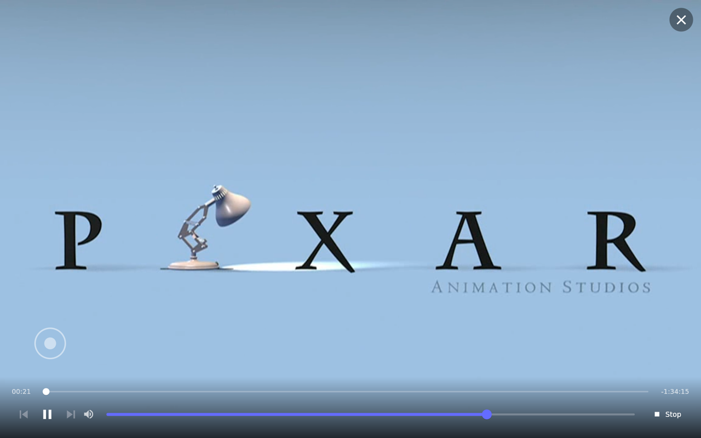

# Hearth

Open-source Flutter smart home kiosk — a Google Nest Hub replacement. It is built for a Raspberry Pi 5 with an 11" AMOLED display, running via [flutter-pi](https://github.com/ardera/flutter-pi), and also runs as an experimental APK on Android kiosk tablets.


https://youtube.com/watch?v=pPN4-EoO-Nc&feature=youtu.be

**User guide: the [Hearth wiki](https://github.com/chrisuthe/Hearth-Home/wiki)** covers setup, every module, and troubleshooting. This README is the project overview and the developer entry point.

## Features

**Photos & ambient**
- [Photo display](https://github.com/chrisuthe/Hearth-Home/wiki/Photos-%26-Ambient-Display) — Immich memories, albums, people, or smart search rotate behind a transparent Home screen, with a face-aware crop.
- [Weather](https://github.com/chrisuthe/Hearth-Home/wiki/Weather) — ambient temperature on Home and a full-screen animated forecast from any HA `weather.*` entity.

**Home Assistant**
- [Controls](https://github.com/chrisuthe/Hearth-Home/wiki/Home-Assistant-Controls) — lights and climate cards over the HA WebSocket, with pinned entities.
- [Calendar](https://github.com/chrisuthe/Hearth-Home/wiki/Calendar) — HA and ICS calendars, read-only, in day, 3-day, week and month views, with an upcoming-events glance on idle Home.
- [Lists & Chores](https://github.com/chrisuthe/Hearth-Home/wiki/Lists-%26-Chores) — HA to-do lists, a per-person chore chart, and a chore glance on idle Home.
- [Web dashboards](https://github.com/chrisuthe/Hearth-Home/wiki/Web-Dashboards) — Lovelace dashboards (signed in automatically) or any URL as a swipe screen.
- [Voice satellite](https://github.com/chrisuthe/Hearth-Home/wiki/Voice-Satellite) — mirrors an Assist satellite's state on the Pi; on Android, Hearth *is* the satellite.
- [MQTT device](https://github.com/chrisuthe/Hearth-Home/wiki/Home-Assistant-Device-%28MQTT%29) — Hearth appears in HA as one device with screen, now-playing, timer, alarm and volume entities.

**Media**
- [Music Assistant](https://github.com/chrisuthe/Hearth-Home/wiki/Music-Assistant) — now playing, queue, multi-player mixer and library browse.
- [Multi-room audio (Sendspin)](https://github.com/chrisuthe/Hearth-Home/wiki/Multi-Room-Audio-%28Sendspin%29) — a synchronized Music Assistant player.
- [Plex Cast](https://github.com/chrisuthe/Hearth-Home/wiki/Plex-Cast) — cast from Plex apps, with Skip Intro, Next Episode and play-queue auto-advance.
- [Live TV](https://github.com/chrisuthe/Hearth-Home/wiki/Live-TV-%28Plex%29) — browse and tune your Plex DVR's channels.
- [Cast to Hearth (DLNA)](https://github.com/chrisuthe/Hearth-Home/wiki/Cast-to-Hearth-%28DLNA%29) — a UPnP/DLNA media renderer.

**Cameras**
- [Frigate](https://github.com/chrisuthe/Hearth-Home/wiki/Cameras-%28Frigate%29) and [UniFi Protect](https://github.com/chrisuthe/Hearth-Home/wiki/Cameras-%28UniFi-Protect%29) — snapshot grids and full-screen live streams.

**Everything else**
- [Recipes](https://github.com/chrisuthe/Hearth-Home/wiki/Recipes-%28Mealie%29) from Mealie.
- [Alarms & timers](https://github.com/chrisuthe/Hearth-Home/wiki/Alarms-%26-Timers) — recurring alarms with sunrise lights and snooze; countdown timers that alert over any screen.
- [Notifications](https://github.com/chrisuthe/Hearth-Home/wiki/Notifications) pushed over MQTT or HTTP.
- [Display & night mode](https://github.com/chrisuthe/Hearth-Home/wiki/Display-%26-Night-Mode) — display profiles, UI scale, landscape or portrait orientation, and night mode by clock, HA entity or API.
- [Navigation & gestures](https://github.com/chrisuthe/Hearth-Home/wiki/Navigation-%26-Gestures) — swipe screens and configurable edge menus.
- [Web portal](https://github.com/chrisuthe/Hearth-Home/wiki/The-Web-Portal) at `http://hearth.local:8090`, at near-full parity with on-device Settings; on-device screenshot and screen-recording tools.
- [OTA updates](https://github.com/chrisuthe/Hearth-Home/wiki/Updating) from GitHub or Gitea releases, with rollback on the Pi.

## Screenshots

Captured from a live Hearth kiosk (Raspberry Pi 5, 11" AMOLED).

| Home — photo display | Embedded HA dashboard (Webview) |
| --- | --- |
|  |  |

| Calendar | Lists & Chores |
| --- | --- |
|  |  |

| Home Assistant Controls | Music Assistant |
| --- | --- |
|  |  |

| Frigate Cameras | Settings — plugin sidebar |
| --- | --- |
|  |  |

| Weather — full-screen forecast | Plex cast — playing |
| --- | --- |
|  |  |

## Install on Raspberry Pi

You need a Raspberry Pi 5 (2 GB+), an 8 GB+ microSD card, a display (11" AMOLED, official 7" touchscreen, or HDMI), and Ethernet or WiFi.

1. Flash **Raspberry Pi OS Lite (64-bit)** with [Raspberry Pi Imager](https://www.raspberrypi.com/software/), with SSH, a user and (if needed) WiFi set in its settings.
2. SSH in and run:

   ```bash
   curl -sL https://raw.githubusercontent.com/chrisuthe/Hearth-Home/main/scripts/setup-pi.sh | sudo bash
   ```

   This installs the dependencies, builds our [flutter-pi fork](https://github.com/chrisuthe/flutter-pi-hearth/tree/hearth), downloads the latest release, and starts Hearth under systemd.
3. Open `http://hearth.local:8090` from any device on your network and enter the PIN shown on the kiosk.

The wiki has the details: [Installation](https://github.com/chrisuthe/Hearth-Home/wiki/Installation), [The Web Portal](https://github.com/chrisuthe/Hearth-Home/wiki/The-Web-Portal) and [Updating](https://github.com/chrisuthe/Hearth-Home/wiki/Updating).

## Install on an Android tablet (experimental)

Hearth runs on arm64 Android 10+ tablets meant to stay on the wall.

1. Download `hearth-android-<version>.apk` from the [latest release](https://github.com/chrisuthe/Hearth-Home/releases/latest).
2. Open it on the tablet and allow installs from that source when Android asks.
3. Launch Hearth. It declares itself a Home app, so you can set it as the tablet's default launcher.
4. Open `http://<tablet-ip>:8090` and enter the PIN shown on the tablet.

Hearth updates itself from later releases. Grant it **Install unknown apps** when it asks; Android then confirms each update.

**Works:** fullscreen kiosk launch, Calendar, Lists & Chores, web dashboards (system WebView), the built-in voice satellite, Sendspin, MQTT, the web portal, screenshots and screen recording, display orientation, and self-update. Camera streams, Plex casting and Live TV have not been tested on a tablet.
**Does not work yet:** alarm and timer sounds (a timer rings through the voice satellite when it is running), notification chimes, WiFi management from Hearth, and the timezone setting (the tablet's own timezone is used).

Per-subsystem status: [`docs/specs/2026-10-13-android-apk-requirements.md`](docs/specs/2026-10-13-android-apk-requirements.md).

## Architecture

**Layers, not routes.** `HubShell` is a permanent stack: the Immich photo carousel at the bottom, a horizontal `PageView` of screens that fades in on touch, ambient overlays (clock, weather, glances) that fade in when idle, edge-swipe menus, and full-screen overlays on top (notifications, alarms, DLNA and Plex cast, Live TV).

**Modules** are screens (`HearthModule`, `lib/modules/`). The registered ones are Alarm Clock, Music, Calendar, Lists, Controls, Cameras (Frigate), Protect (UniFi), Recipes (Mealie) and Live TV (`lib/modules/module_registry.dart`); one Web Dashboard module is added per configured URL. Each module's `defaultOrder` sets the swipe order around Home:

**Music ← Alarms ← Home → Calendar → Lists → Controls → Live TV → Cameras → Protect → Recipes → Settings**

Only Music, Controls and Cameras are enabled out of the box. A module can sit in the swipe row, an edge menu, or both.

**Plugins** are settings panels (`lib/plugins/`). Each renders itself twice from one definition — a widget for on-device Settings and HTML for the `:8090` portal — which keeps the two at parity. The portal and the `/api/*` endpoints are served by `LocalApiServer`.

**Plex** plays two roles from one `plex.tv/link` pairing: a GDM-advertised cast sink, and a client that tunes Live TV through the DVR.

**Video on Pi** uses GStreamer through our flutter-pi fork, whose `hearth` branch fixes a live-pipeline deadlock; web dashboards render with WPE WebKit. Desktop and Android use media_kit.

**Android** hosts the voice satellite (our [Ava fork](https://github.com/chrisuthe/Ava-hearth)) and Sendspin ([SendspinDroid](https://github.com/chrisuthe/SendspinDroid)) in one native foreground service, driven from Dart over platform channels.

Built with Flutter, Riverpod, flutter-pi, GStreamer, WPE WebKit, media_kit and the Home Assistant WebSocket API. [`CLAUDE.md`](CLAUDE.md) has the architecture in depth, and [`docs/specs/`](docs/specs/) the design records.

## Development

```bash
flutter pub get
flutter run -d windows        # or -d linux
flutter analyze
flutter test
flutter test test/portrait    # every surface at landscape and portrait sizes
```

**Android** needs JDK 17 and the Android SDK:

```bash
git submodule update --init   # the Ava fork and SendspinDroid
flutter build apk --debug
./scripts/build-android-apk.sh   # release arm64 APK, as CI builds it
```

**Target hardware:** Raspberry Pi 5 with the 11" AMOLED (2368x1728, rendered at 1184x864). Layouts must also hold in portrait at 864x1184 and 800x1280; `test/portrait/` checks all three. The official 7" touchscreen and HDMI monitors are supported too.

**Releasing:** every merge and release goes to both remotes (GitHub and Gitea), because devices update from either. [`docs/RELEASING.md`](docs/RELEASING.md) has the full process.

```bash
./scripts/sync-remotes.sh               # after a merge: push main to both remotes
./scripts/release.sh --bump <version>   # bump, tag, and push the tag to both
```

Contributions are welcome — see [`CONTRIBUTING.md`](CONTRIBUTING.md).

## License

MIT

Hearth's builds also ship third-party code, fonts, sounds and models under their own licences, among them our fork of [Ava](https://github.com/chrisuthe/Ava-hearth) (Apache-2.0) and [SendspinDroid](https://github.com/chrisuthe/SendspinDroid) (MIT) in the Android build. [`THIRD_PARTY_NOTICES.md`](THIRD_PARTY_NOTICES.md) lists them, and the app shows the licence texts under Settings → System → Open-source licences.
