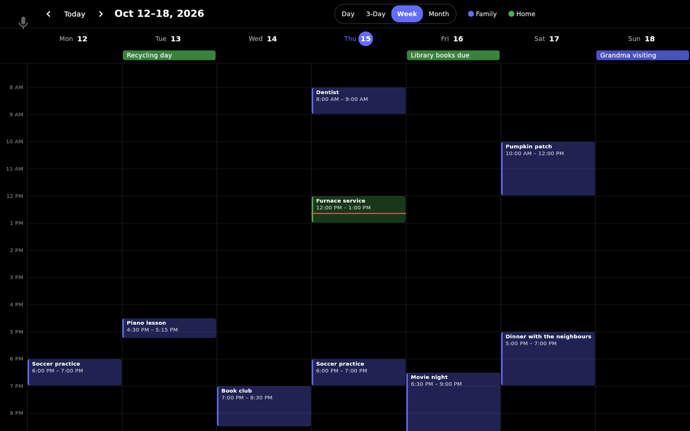

# Calendar

A read-only family calendar on the kiosk: **Home Assistant calendars** and **ICS / iCal feeds**
side by side, in **Day**, **3-Day**, **Week** and **Month** views, plus a short list of what's
coming up on the idle Home screen.

Hearth never creates, edits or deletes events. Make changes in the calendar itself (Google,
Outlook, the HA calendar panel…) and they show up here.

## Add calendars

In the [[web portal|The Web Portal]] or on-device Settings, open **Calendar** and add sources.
There are two kinds:

| Kind | What you give it | Good for |
| --- | --- | --- |
| **Home Assistant** | A `calendar.*` entity, e.g. `calendar.family` | Anything HA already has: Google, CalDAV, Outlook, Local Calendar |
| **ICS feed** | An `http://`, `https://` or `webcal://` URL | Public feeds (holidays, school, sports) and calendars you don't want in HA |

- **Home Assistant** sources need a working [[Home Assistant connection|Home Assistant Controls]].
  The name and colour default to what HA has for the entity.
- **ICS feeds** are fetched once before they're added: **Test** reports the calendar's name and
  event count, and the button then becomes **Add**. A feed's URL can contain a secret (Google's
  "secret address" does); Hearth never shows it again after it's saved.

Each source has a **name**, a **colour**, an **on/off** switch and, optionally, the person it
**belongs to** (from [[People]]). The owner is stored for now and shown in Settings; the Calendar
screen doesn't filter by person yet. To change a URL or entity, delete the source and add it again.

Then put **Calendar** on the swipe row (or a menu) in **Screens & Order** — see
[[Navigation & Gestures]]. It isn't placed anywhere until you do. On the swipe row it sits just
right of Home unless you reorder it.

### Options

| Option | What it does |
| --- | --- |
| **ICS refresh interval** | How often ICS feeds are fetched again: 15 minutes to 24 hours (default 30 minutes). Feeds that support it answer "not modified", which costs almost nothing |
| **Show upcoming events when idle** | The glance on the idle Home screen (below). On by default |
| **Default view** | The view the Calendar screen opens in: Day, 3 days, Week (default) or Month |

Home Assistant 2026.5 and newer push calendar changes to Hearth as they happen, so the interval
only matters for HA calendars on an older Home Assistant, which Hearth polls at the same rate.

## The Calendar screen

- **‹ Today ›** pages back and forward by the view's length; **Today** jumps back.
- **Day / 3-Day / Week / Month** switches the view.
  - **Week** shows seven columns with an all-day row on top, opened a little before the current
    hour, with a white line at the current time. On a portrait screen it shows **3 days**
    instead — seven columns don't fit.
  - **Day** adds an agenda of the following days beside the hours (below them in portrait). The
    event happening now is marked **Now**.
  - **Month** shows each day's events as chips; multi-day events stretch across days. On a narrow
    portrait screen days show dots, and tapping a day lists its events under the month.
- **Events are filled in their calendar's colour**, and ones that have already ended are dimmed.
  A tentative event is drawn as an outline.
- **The calendar pills** under the header show every source in its colour, with its initial. Tap
  one to hide it from the screen for now (it turns into an outline); tap again to bring it back.
  This doesn't change Settings.
- **Tap an event** for its details: time, location and notes.

When a source can't be read, the screen keeps the events it last had and shows a banner under
the header saying which source and why — amber when it's showing older events, red when it has
none (for example *Calendar not found at this URL*).

## The idle glance

The Home screen, where the kiosk returns when idle, shows up to **three** upcoming events from
now to the end of tomorrow on a frosted card above the timer pill, grouped under **Today** and
**Tomorrow** — today's all-day events first, and the one happening now marked **Now**. When Calendar is on the swipe
row, tapping the glance opens it. It hides itself when there's nothing coming up, no source is on, or the option is off.

## Troubleshooting

- **A Home Assistant source says *Entity not found in Home Assistant*** — check the entity ID in
  HA (Developer Tools → States). It must start with `calendar.`.
- **A Home Assistant source says *Can't reach Home Assistant*** — the HA connection itself is
  down; see [[Home Assistant Controls]].
- **An ICS source says *Calendar not found at this URL* or *The server refused the calendar*** —
  the URL is wrong or private. Open it in a browser; it should download a `.ics` file. Hearth
  doesn't retry these until the next refresh.
- **An ICS source says *Can't reach the calendar server* or *timed out*** — a network problem.
  Hearth keeps the last events it had and retries after 1, 2, 4… minutes.
- **An ICS source says *Calendar is larger than 10 MB*** — Hearth won't load feeds over 10 MB.
  Many servers can export a shorter range.
- **Events are at the wrong time** — check the kiosk's **Timezone** in
  [[Display & Night Mode]].

## On Android

Calendar works the same on an [[Android Tablet]]. The one difference: Hearth's timezone setting
has no effect there, so event times follow the tablet's own timezone. Set it in Android's
settings.
