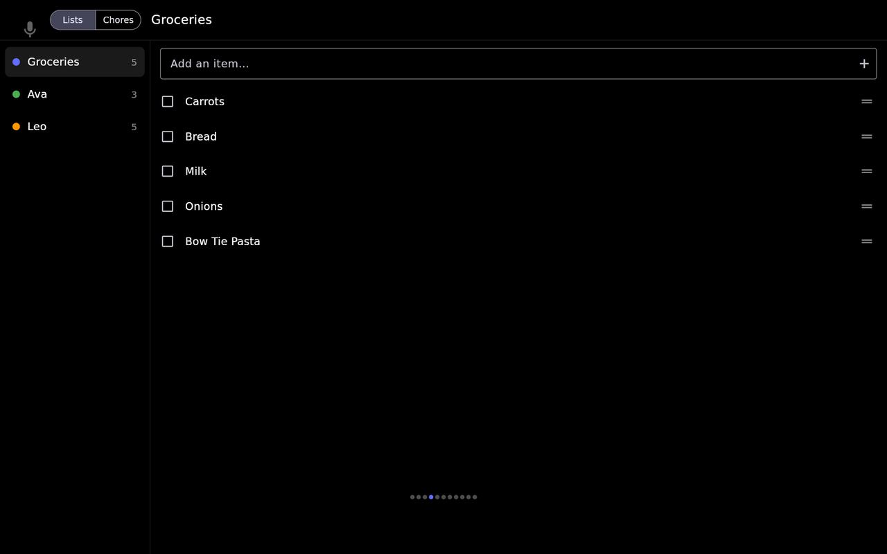

# Lists & Chores

Shared lists and a chore chart on the kiosk, built on **Home Assistant to-do lists**: shopping,
packing, a list per person's chores. Tick things off, add, edit, reorder and delete from the
kiosk; the changes land in Home Assistant, and changes made anywhere else show up on the kiosk
at once.

Hearth keeps no lists of its own. Every item lives in Home Assistant, so the HA app, a voice
assistant and the kiosk all see the same list.


## Add lists

First create the lists in Home Assistant (**Settings → Devices & services → Add integration**).
Any integration that makes a `todo.*` entity works; these are the common ones:

| Integration | What it gives you |
| --- | --- |
| **Local To-do** | A list stored in HA, one per entry. Due dates, due times and descriptions. Good for chores |
| **Shopping List** | HA's built-in shopping list. Items only, no dates |
| **Google Tasks**, **Todoist**, **CalDAV**… | Lists kept in another service. Google Tasks is polled, so changes made in Google take up to 30 minutes to reach HA |

Then, in the [[web portal|The Web Portal]] or on-device Settings, open **Lists** and **Add** each
one. Each list has a **name** (it defaults to HA's), a **colour**, and a **person**:

- Leave **person** at *No one* for an ordinary list (shopping, packing).
- Pick someone — *Ava's chores* — to make it that person's **chore list**. A person can have more
  than one; their chores are shown together.

The person list comes from [[People]], so add the household there first. A config from before
People had the person typed as a name; Hearth turns each name into a person when it starts, so
nothing needs redoing.

Each row says what the list can do (*add · edit · reorder · due dates*), read from Home
Assistant. To point a row at a different list, delete it and add it again.

Then put **Lists** on the swipe row (or a menu) in **Screens & Order** — see
[[Navigation & Gestures]]. It isn't placed anywhere until you do. On the swipe row it sits right
of Calendar unless you reorder it.

### Options

| Option | What it does |
| --- | --- |
| **Show today's chores when idle** | The glance on the idle Home screen (below). Off by default |

## The Lists view



- **The left rail** lists every list with its open count. Tap one to open it. On a portrait
  screen the rail becomes a dropdown at the top.
- **Add an item…** at the top: type and press Enter. The field stays ready for the next item.
- **Tick the box** to complete an item; completed items fold under **Completed (n)**. Open it and
  untick to bring one back. **Clear done** removes the completed items from Home Assistant, after
  asking.
- **Drag the handle ≡** to reorder. The order is saved in Home Assistant, so HA's to-do card shows
  the same order.
- **Tap an item** to edit it: name, and — when the list supports them — description, due date and
  due time. **Delete** removes it straight away.

Hearth only offers what the list supports. A Shopping List item has a name and nothing else, so
its sheet has no date or description.

## The Chores view

Switch with **Lists / Chores** at the top; Chores appears once a list has a person. Each person
gets a column showing, in order:

1. chores **late** (due before now) — marked *late*;
2. chores due **today**;
3. chores with **no due date** (they show every day);
4. chores **done today**, struck through.

Chores due later wait under **Upcoming (n)**. Each column takes its name and colour from the
person; someone linked to Home Assistant shows their picture and a dot for whether they're home.
The count beside the name is done over total for today. Tap a chore to tick it off; tap again to undo. On a narrow screen columns wrap into rows.

## The idle glance

With **Show today's chores when idle** on, the Home screen (where the kiosk returns when idle)
shows up to **three** of today's open chores —
late ones first — above the calendar glance, with *+n more* when there are others. Chores with no
due date are left out. Tap it to open the Chores view (when Lists is on the swipe row). It hides
itself when nothing is due.

A chore due at a time turns *late* at that time, and yesterday's open chores turn *late* at
midnight, without anything changing in HA.

## Repeating chores

Home Assistant to-do lists have no "repeat", so a chore that comes back every day is an HA
automation that adds it again. This one runs just after midnight, clears yesterday's finished
chores, adds *Make bed* for today, and on Thursdays *Trash out* for 7 PM (replace `todo.ava_chores`
with the person's list):

```yaml
alias: Ava's chores
triggers:
  - trigger: time
    at: "00:05:00"
actions:
  - action: todo.remove_completed_items
    target:
      entity_id: todo.ava_chores
  - action: todo.add_item
    target:
      entity_id: todo.ava_chores
    data:
      item: Make bed
      due_date: "{{ now().date() }}"
  - if:
      - condition: time
        weekday: [thu]
    then:
      - action: todo.add_item
        target:
          entity_id: todo.ava_chores
        data:
          item: Trash out
          due_datetime: "{{ today_at('19:00') }}"
```

A chore still open from yesterday stays, marked *late*, next to today's.

## Troubleshooting

- **A list says *List not found in Home Assistant*** — check the entity ID in HA (Developer Tools →
  States). It must start with `todo.`.
- **A list says *Can't reach Home Assistant* or *Lost connection to Home Assistant*** — the HA
  connection itself is down; see [[Home Assistant Controls]]. Hearth keeps showing the last items
  and catches up when it reconnects.
- **A list says *Home Assistant 2023.12 or newer is needed for lists*** — update Home Assistant.
- **A change made in Google Tasks takes a while to appear** — HA polls Google Tasks every 30
  minutes.
- **Chores are a day off** — check the kiosk's **Timezone** in [[Display & Night Mode]].

## On Android

Lists and chores work the same on an [[Android Tablet]]. Hearth's timezone setting has no
effect there, so "today" and *late* follow the tablet's own timezone.
