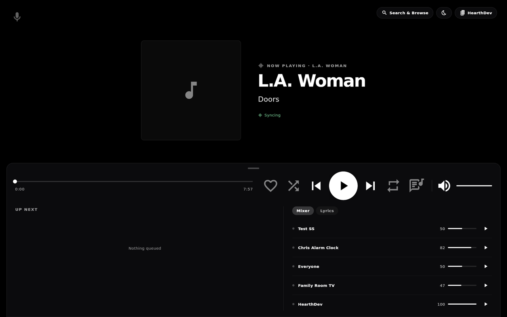
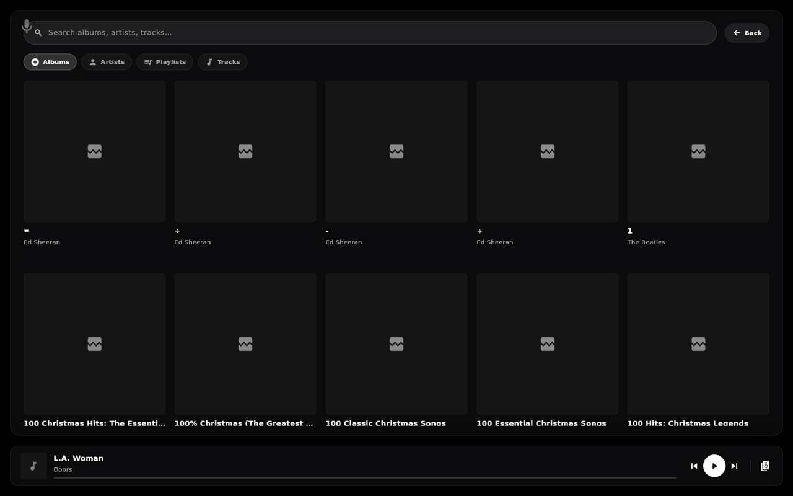

# Music Assistant

The **Music** screen is a full-bleed, cinematic now-playing player backed by
[Music Assistant](https://music-assistant.io/): album art bleeds edge to edge behind the track,
a drag-up shelf holds the transport and queue, and a browse overlay searches your whole library.
Music Assistant connects **directly** — it does not depend on Home Assistant.

## Connect Music Assistant

In the [[web portal|The Web Portal]] or on-device **Settings**, open **Music Assistant** and
enter:

| Field | Example | Where to get it |
| --- | --- | --- |
| **Music Assistant URL** | `http://192.168.1.x:8095` | Your Music Assistant server |
| **Music Assistant Token** | *(paste it)* | A Music Assistant long-lived token |

Until it connects, the Music screen shows **"Music Assistant not connected"** with a pointer
back to Settings.

The Music screen is in the swipe row by default, left of Home. To move it or put it in an edge
menu, use **Screens & Order** — see [[Navigation & Gestures]].

## Options

- **Default Music Zone** — the player Hearth controls by default, as its **Music Assistant
  player ID**. For a player Music Assistant imports from Home Assistant, that's the entity ID
  (e.g. `media_player.living_room`). If you leave it blank, the connection still works but
  the plugin is marked *partial*.

Which player the Music screen opens on, in order:

1. Hearth's own [[Sendspin|Multi-Room Audio (Sendspin)]] player, when Sendspin is enabled.
2. The **Default Music Zone**.
3. The first player that's playing.
4. The first available player.

Picking a player from the **Players** popover overrides this until Hearth restarts.

## Using the Music screen

**The backdrop** is built from the current track's album art, so the whole screen takes on the
colour of what's playing. Tracks without art fall back to a plain dark background.

**The hero** shows the album art alongside a `NOW PLAYING · <album>` eyebrow, the track title,
and the artist.

**The top chrome** is a row of chips:

- **Search & Browse** — opens the library overlay (below).
- **Sleep** (moon icon) — not wired up yet.
- **Players** — the active player's name, a **+N** when other players are grouped with it, and
  a green dot while it plays. Tap to open the players popover.

**The shelf** along the bottom is a **drag drawer**, not a fixed panel. It starts *minimal* —
just the transport. Drag the handle at its top edge **up** and it grows to *expanded*; let go
and it snaps to whichever stop is nearer. It tracks your finger the entire way.

What appears as it rises:

- **Minimal** — the transport row and the progress bar with elapsed / total time.
- **Lift it off the bottom** — the **Up Next** queue lane slides in, showing what's coming
  (or *"Nothing queued"*). Tap a card to jump to that track.
- **Expanded** — the right pane appears with a **Mixer** tab: every Music Assistant player
  listed with a playing indicator, its own **volume slider**, and a play/pause button — so you
  can balance a multi-room group without leaving the screen.

**The transport row**, left to right: heart, shuffle, previous, play/pause, next, **repeat**
(tap to cycle *off → all → one*), lyrics, and the active player's volume bar (tap or drag).
Shuffle and repeat dim when inactive. The progress bar shows elapsed / total time; it isn't a
scrubber. On a narrow (portrait) screen the heart and lyrics buttons are left out and the
progress bar sits on its own line.

**The players popover** — tap the **Players** chip. Only players Music Assistant reports as
available are listed. From here you can:

- **Switch players** — a chip for each player or group across the top; tap one to drive it.
- **Transfer here** — move what's playing onto the selected player.
- **Group volume** — one slider for the whole group.
- **Group and ungroup** — tick a player under **Available** to add it to the group, untick it
  under **In this group** to remove it. Each player has its own volume slider and a
  **Mute** button.
- **Pause all** / **Stop group** — along the bottom.

Tap outside the popover to close it.

> **Not wired up yet:** the **heart**, the **Sleep** chip, the **lyrics** button, and the
> **Lyrics** tab are drawn but currently do nothing. They're placeholders for planned
> features, not broken settings.

## Browsing your library

Tap **search** in the top chrome to open the **browse overlay**.

- **Search** — one box across **tracks, albums, artists, and playlists**; results are grouped
  by type. It searches as you type.
- **Tabs** — with the search box empty, browse the library by **Albums**, **Artists**,
  **Playlists**, or **Tracks** as a grid.
- **Tap any tile** for its actions: **Play Now**, **Play Next**, **Add to Queue**, or
  **Clear Queue & Play**.

While the overlay is open, a **mini bar** stays pinned at the bottom so you keep play/pause,
next/previous, and the players popover without closing it. Tap **Back**, or the album art in
the mini bar, to return to the player.

## Troubleshooting

- **"Music Assistant not connected"** — confirm the URL and token are correct and the server is
  reachable from the kiosk.
- **Connected, but no player** — set **Default Music Zone** to a real Music Assistant player
  ID, or pick one from the players popover. Players that Music Assistant reports as unavailable are
  filtered out.
- **Multi-room out of sync** — that's a Music Assistant concern; also see
  **[[Multi-Room Audio (Sendspin)]]** if you want Hearth itself to be a synced player.
- **I want to cast video, not music** — see [[Cast to Hearth (DLNA)]] and [[Plex Cast]].
