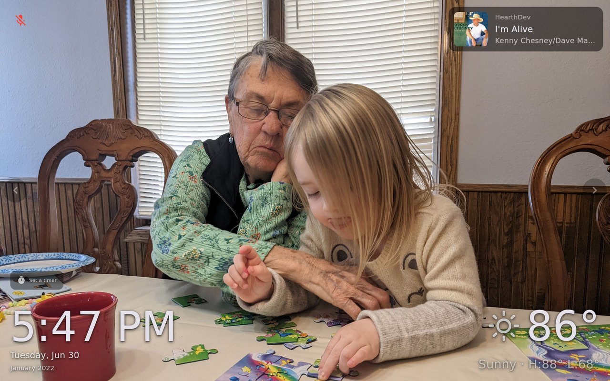

# Photos & Ambient Display

The Home screen is transparent — your photos are *always* the background. Hearth pulls
them from [Immich](https://immich.app/), your self-hosted photo library, and rotates them
behind a large clock, the weather, and a memory label. This page covers connecting Immich,
the four photo sources, and what the Home screen shows over them.

## Connect Immich

In the [[web portal|The Web Portal]] (`http://hearth.local:8090`) or on-device Settings,
open **Immich** and enter:

| Field | Example | Where to get it |
| --- | --- | --- |
| **Immich URL** | `http://192.168.1.x:2283` | Your Immich server address |
| **API Key** | *(paste your key)* | Immich → **Account Settings → API Keys → New API Key** |

Once the URL and key are saved, the **Photo sources** section below them comes to life and
loads your albums and people.

## Photo sources

Photo sources are independent toggles — enable as many as you like and Hearth **mixes and
shuffles** them into one carousel (each enabled source contributes up to 50 photos).

### Memories ("On This Day")
On by default. Shows Immich's "on this day" memories — photos from this date in past years.
No extra configuration.

### Album
Toggle it on, then pick one album from the dropdown (each entry shows its name and photo
count). If you enable Album but don't pick one, Settings warns you to *pick an album*.

### People
Toggle it on to show photos of specific people. Immich's face recognition powers this —
tagged, named people appear as chips (with a photo count each); tap to select one or more.

> If you see *"No named people found in Immich. Tag faces in Immich first."*, go tag and
> name some faces in Immich, then reopen this panel.

### Smart search
Toggle it on and type a free-text query — Hearth uses Immich's CLIP smart search to find
photos that *look like* your query. It searches image content, not filenames.

- Placeholder: *"e.g. beach, sunset, autumn leaves"*
- Works best for visual concepts like `beach` or `sunset`.

### Weights: how much of each source

Once two or more sources are active, each one gets a **share** slider from 1 to 5. The shares
set how much of the rotation each source gets, relative to the others: Memories at 2 and Album
at 1 shows about two memories for every album photo. All at 1 (the default) is an even split.
A source with fewer photos than its share repeats to fill it.

## How the photos rotate

- A new photo crossfades in every **15 seconds**.
- Hearth re-reads your sources from Immich every **5 minutes**, so new memories and album
  additions show up without a restart.
- On the Home screen, tap the **‹ ›** arrows at the left and right edges to step back or
  forward. Skipping restarts the 15-second count.

## Face-aware cropping

Photos are cropped to fill the panel, but the crop is **face-aware** — it biases toward
detected faces so people don't get cut off at the edge.

## What the Home screen shows

The Home screen draws its content straight over the photo. When the kiosk has been left alone
for the **Idle Timeout** (see [[Display & Night Mode]]) it slides back to Home, so this is what
an idle kiosk shows:

- **Clock and date** — bottom left. Under them, the **memory label** for the photo on screen:
  *3 years ago today* for a memory, or the month and year (*August 2023*) for a photo from an
  album, people or smart search.
- **Weather** — bottom right: the condition icon, the temperature and the day's high and low.
  Tap it for the full forecast; see [[Weather]].
- **Now playing** — top right, when a [[Music Assistant]] player has a track loaded. Tap it
  to open the Media screen.
- **Timer pill** — above the clock: *Set a timer*, or the running timers. Tap it to open the
  timer screen; see [[Alarms & Timers]].
- **Glances** — above the timer pill: today's chores and upcoming events, each only when there
  is something to show. See [[Lists & Chores]] and [[Calendar]].

On a portrait screen the weather sits above the clock instead of beside it.

- **Clock format** — the 12-hour / 24-hour toggle lives on the **[[Display|Display & Night Mode]]**
  page (**Use 24-Hour Clock** in the portal, **24-Hour Clock** on the device).
- **Weather** — open **Weather** in Settings and set the **Weather Entity ID** to a
  Home Assistant weather entity (e.g. `weather.pirate`). This reuses your
  [[Home Assistant connection|Home Assistant Controls]], so no separate URL or key is needed.

*📷 Planned screenshot — the Immich panel at `:8090` showing the four photo-source toggles. See [[SHOTLIST]].*

## Troubleshooting

- **No photos appear** — confirm the Immich URL is reachable from the kiosk and the API key is
  valid. See [[Troubleshooting & FAQ]].
- **A source is enabled but empty** — Settings shows a warning; make sure you picked an
  album / at least one person / entered a search query.
- **Albums or people say *Couldn't load*** — Hearth can't reach Immich with that URL and key.
  Check both, then reopen the panel.
