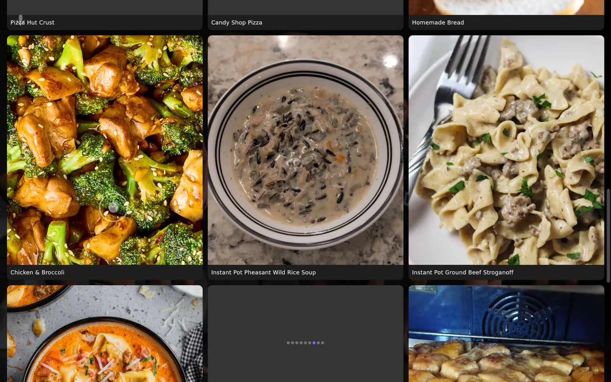

# Recipes (Mealie)

The **Recipes** screen browses and displays recipes from your
[Mealie](https://mealie.io/) server — handy for pulling up a recipe on the kiosk while you
cook.

## Connect Mealie

In the [[web portal|The Web Portal]] or on-device Settings, open **Mealie** and enter:

| Field | Example | Where to get it |
| --- | --- | --- |
| **Mealie URL** | `http://192.168.1.x:9925` | Your Mealie server |
| **Mealie Token** | *(paste it)* | Mealie → your user profile → **API Tokens** |

Both are required for the Recipes screen to load; without them it shows *Recipes not
configured*.

Then put **Recipes** on the swipe row (or a menu) in **Screens & Order** — see
[[Navigation & Gestures]]. It isn't placed anywhere until you do.

## Using the Recipes screen

- **Today's Menu** — when your Mealie meal plan has entries for today, they show as a row of
  cards at the top. Tap one that links a recipe to open it.
- **Search** — type in **Search recipes...** to search your whole library (up to 20
  matches).
- **Category filter** — tap a category chip to narrow the grid to it; tap it again to clear.
- **Browse** — without a search or filter, the grid shows your first 30 recipes, each with
  its image and total time.
- **Recipe detail** — tap a recipe for its image, prep and cook times, an **Ingredients** list
  you can tick off as you go, and numbered **Instructions**. The back arrow returns to the
  grid.

## Troubleshooting

- **Recipes don't load** — confirm the URL is reachable from the kiosk and the token is valid.
  Tokens are created per-user in Mealie. See [[Troubleshooting & FAQ]].
- **Today's Menu never appears** — it only shows when today has a meal plan entry, and Hearth
  reads the meal plan the way Mealie 2.0 and newer serve it. Update an older Mealie.
