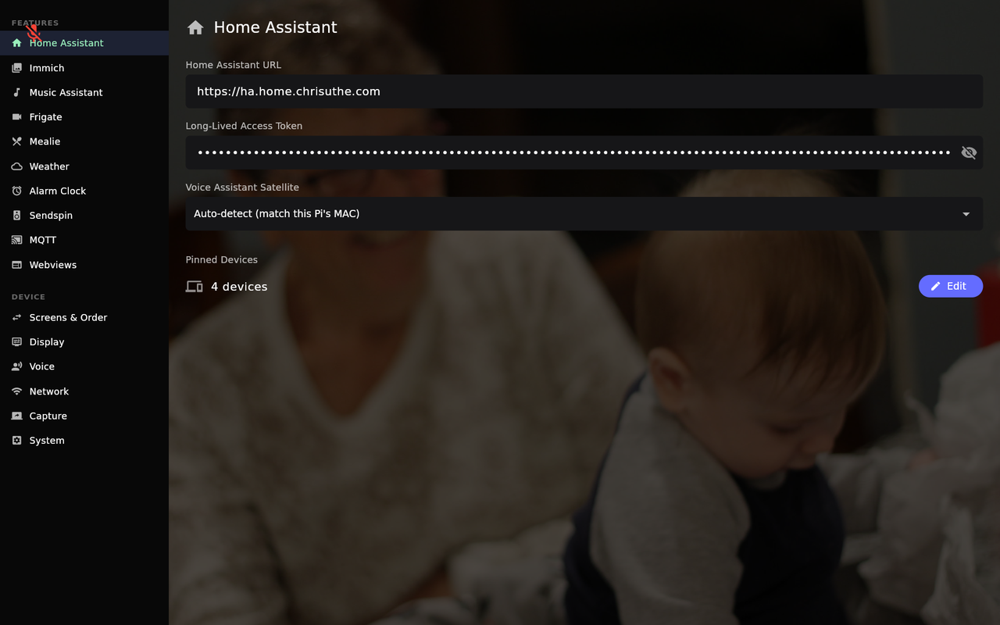

# The Web Portal

The web portal at **`http://hearth.local:8090`** is where you configure Hearth. It mirrors
the on-device Settings screen as a **plugin sidebar**, so nearly everything can be set up
from a browser on your phone or laptop instead of typing on the kiosk.

Almost every other page in this wiki points back here — when a page says "open **X** in the
portal sidebar," this is the surface it means.


*The on-device Settings screen — the portal presents the same plugins in a browser.*

## Getting in

1. On any device on the same network, browse to `http://hearth.local:8090`.
   - If `hearth.local` doesn't resolve, use the kiosk's IP address: `http://<kiosk-ip>:8090`.
     The **[[Network|Network & System]]** panel on the kiosk shows the exact address and a QR
     code.
   - On an **[[Android Tablet]]** always use the IP address — `hearth.local` is the Pi's name.
2. Enter the 4-digit **PIN** shown in the kiosk's **Network** panel.
3. You're in. Your browser stays signed in for a day, or until Hearth restarts, whichever
   comes first.

The PIN gates the portal so only someone who can see the kiosk can configure it. A new PIN
is generated each time Hearth starts.

## How the sidebar is organized

Plugins are grouped into two categories, in this order:

- **Feature** — external services and features: Home Assistant, Immich, Music Assistant,
  Frigate, UniFi Protect, Calendar, Lists, Mealie, Weather, Alarm Clock, Sendspin, DLNA
  Cast, Plex Cast, MQTT, Webviews.
- **Device** — settings about the kiosk itself: Screens & Order, Display, Voice, Network,
  Capture (when enabled), System.

Each plugin shows a **status dot**: configured, needs setup, partially set up, or an active
error (e.g. Home Assistant disconnected). **Capture** is hidden until you turn on *Capture
tools* under **[[System|Network & System]]**.

Everything you change **saves immediately** — there is no save button.

A few things can only be done on the kiosk itself, such as choosing the **Display Profile**
and the first switch-on of **[[DLNA|Cast to Hearth (DLNA)]]**. The page for each feature
says so where it applies.

## The API key (for scripts)

Beyond the PIN-gated browser session, Hearth has an **API key** that lets scripts and Home
Assistant call its `/api/*` endpoints with an `Authorization: Bearer <key>` header. It's
generated on first run and never changes. The portal doesn't display it or let you change it.

To read it, sign in to the portal, then open this address in the same browser:

```
http://<kiosk-ip>:8090/api/session/key
```

It returns `{"apiKey": "…"}`. Treat the key like a password — anyone with it can change
Hearth's settings.

You don't need the API key for normal setup; it's for people who want to drive Hearth from
elsewhere on the network — send **[[Notifications]]**, switch
**[[night mode|Display & Night Mode]]**, start an **[[update|Updating]]**, or manage
**[[alarms|Alarms & Timers]]**.

## Backup & Restore

**System** in the portal sidebar has a **Backup & Restore** section. Use it to rebuild a
kiosk after its SD card dies, or after the tablet is wiped, without setting everything up
again.

- **Download backup** saves one `.json` file. It holds the whole configuration (servers,
  people, lists, calendars, webviews and every other setting), your alarms, and the
  Sendspin pairing keys. With the keys back, Music Assistant still sees the same player.
- **The file contains every password and token Hearth uses**, in plain text. Keep it
  somewhere safe.
- **Restore from file** puts it all back and restarts Hearth. The portal waits for the
  restart and reloads. Sign in again with the **new PIN** the kiosk shows.

Things to know:

- A restore brings the kiosk back as **the same device**, so Home Assistant, Plex, DLNA and
  MQTT recognise it. Don't use a backup to set up a *second* kiosk: the two would clash.
- A backup from a **newer** Hearth version is refused. Update the kiosk first, then
  restore.
- Sendspin keys only restore onto the same kind of device. A Pi backup restored onto a
  tablet brings back everything except Sendspin pairing.
- Wi-Fi, photos and captures aren't included.
- Both buttons need the PIN-signed-in portal. The API key alone can't download or restore a
  backup.
- The files a restore replaces are kept beside the new ones with a `.pre-restore` suffix,
  in case you need to undo it by hand.

## The logs page

The portal also serves a **logs** page at `http://<kiosk-ip>:8090/logs` — it isn't linked
from the sidebar, so type the address (you need to be signed in). It shows the kiosk's recent
log output (50–500 lines, with auto-refresh) plus live system stats: CPU and GPU
temperature, load, memory, and uptime. It's the first place to look when something isn't
behaving. Use **Settings** at the top to get back. See [[Troubleshooting & FAQ]].

## On Android

The portal works the same on an Android tablet, at `http://<tablet-ip>:8090`. The **logs**
page doesn't work there yet, and the system stats show memory only.
