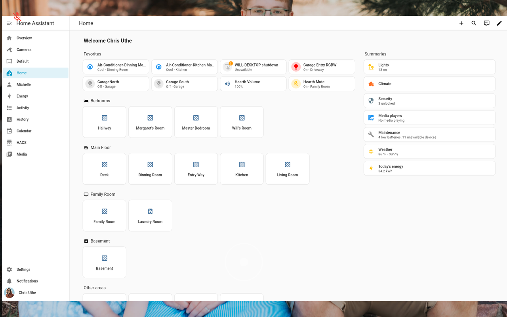

# Web Dashboards

Hearth can render **Home Assistant Lovelace dashboards** — or **any web page** — as
full screens alongside its own. On the Pi they render through WPE WebKit; on Android, through
the tablet's system WebView. Each dashboard you add becomes its own screen, which you can put
on the swipe row or an edge menu.

## Adding dashboards

Open **Webviews** in the [[web portal|The Web Portal]] or on-device Settings. There are two
sections:

### Home Assistant dashboards
If [[Home Assistant is connected|Home Assistant Controls]], Hearth **auto-discovers** your
Lovelace dashboards and lists them with checkboxes — tick the ones you want as screens. Use
**Refresh** to re-fetch the list after adding dashboards in HA.

HA dashboards are **token-injected**: Hearth writes your long-lived token into the page at
load, so the dashboard comes up already signed in — no login prompt on the kiosk. The token is
only ever given to your HA address, never to custom URLs.

Home Assistant lists only the dashboards you created, so the default **Overview** isn't offered
here. To show it, make a dashboard in HA (you can copy Overview into it) and tick that one.

**Dark mode for HA dashboards** (on by default) asks HA dashboards to draw dark. It only works
when the HA user's theme is left on the default/Auto; a theme you picked in HA wins. It doesn't
affect custom URLs.

> If you see *"Configure Home Assistant connection first to auto-discover dashboards,"* set up
> the [[HA connection|Home Assistant Controls]] first.

### Custom URLs
Press **+ Add** to add any URL as a screen. Each custom dashboard has:

- **Name** — the label shown for the screen.
- **URL** — e.g. `https://…`.
- **Icon** — pick from a small set (Dashboard, Web, Analytics, Chart, Electrical, Shopping,
  Print, Cloud, Security, Thermostat).

You can edit or delete custom URLs later from the same panel. Custom URLs load as a fresh
browser would: nothing is signed in for them.

## How web screens behave

- **Touch** — taps, long-presses, and vertical scrolling pass through to the page.
  *Horizontal* drags are reserved for swiping between Hearth screens, so a left/right swipe
  navigates Hearth rather than the page.
  Drags that start in the top or bottom edge strip still open Hearth's menus.
- **Stays warm** — up to four web screens stay loaded in the background, so swiping back to
  one doesn't reload it. Past four, the one you used longest ago is closed and reloads next
  time.
- **Idle pause** — when the kiosk goes idle, web pages pause (they stop drawing but stay
  loaded) and resume when you come back to them.
- **Auto-restart** — if a page fails to load, the screen shows *Reconnecting to …* with the
  error and a **Retry** button, and Hearth tries again by itself every few seconds.

## Placement

A new web dashboard isn't placed anywhere at first. Open **Screens & Order** and put it on the
swipe row or an edge menu — see **[[Navigation & Gestures]]**. On the swipe row, web dashboards
sit after the built-in screens unless you reorder them.

## Troubleshooting

- **HA dashboard shows a login screen** — the token injection didn't take; re-check the HA
  URL/token and that the dashboard URL matches your HA instance.
- **A page renders blank** — some sites block embedding; try a different URL. See
  [[Troubleshooting & FAQ]].

## On Android

Web dashboards work on an [[Android Tablet]] through Android's system WebView: HA dashboards
sign in the same way, touch and edge swipes behave the same, and pages pause when idle and keep
their scroll position when you come back. Landscape hasn't been tested on a tablet yet.
